# Context Mapping

> **Nota sobre os recursos visuais e as fontes:** os diagramas, o Context Map Cheat Sheet e os recursos do Miro reutilizados nesta tradução permanecem em inglês. Na primeira ocorrência de um rótulo visual relevante, o termo original é apresentado entre parênteses para facilitar sua identificação. As definições atribuídas ao **DDD Reference**, de Eric Evans, foram traduzidas para fins de localização, mantendo os links e a atribuição da fonte original.

Os **Mapas de Contextos (*Context Maps*)** descrevem as relações entre contextos delimitados e times por meio de um conjunto de padrões. Existem nove padrões de Context Mapping e três tipos de relacionamento entre times. Esses padrões apresentam diferentes perspectivas, como fornecimento de serviços, propagação de modelos e aspectos de governança. Essa diversidade permite obter uma visão abrangente das relações entre times e contextos delimitados.

Os Mapas de Contextos podem ser usados para analisar sistemas existentes ou paisagens de aplicações, mas também são adequados para decisões de design antecipadas. Muitas pessoas, entretanto, encontram dificuldades para começar a utilizar os padrões de Context Mapping com base apenas nas definições presentes nos livros de DDD. Este repositório busca ajudar nesse processo oferecendo um guia de referência rápida (*cheat sheet*) e um kit inicial para o Miro.

## Visão geral das relações entre times e dos padrões do Mapa de Contextos

### Relações entre times (*Team Relationships*)

#### Mutuamente dependentes (*Mutually Dependent*)

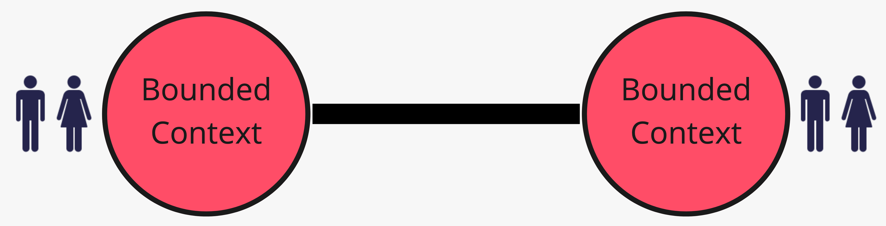

Dois times ou contextos delimitados são mutuamente dependentes quando seus artefatos de software ou sistemas precisam ser entregues em conjunto para funcionar e alcançar o resultado esperado. Normalmente existe uma relação próxima e recíproca entre os dados, as funcionalidades e as capacidades desses times. Eles também precisam se comunicar com frequência para coordenar seus esforços — consulte o padrão Parceria (*Partnership*).

#### Upstream e downstream (*Upstream / Downstream*)

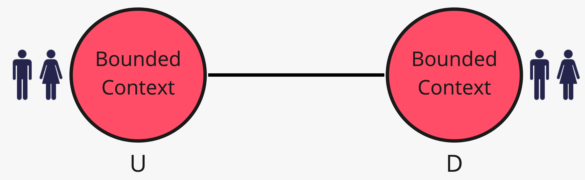

As ações de um time *upstream* afetam o time *downstream*, enquanto as ações do *downstream* não causam impacto significativo no *upstream*.

> “O time upstream pode ser bem-sucedido independentemente do destino do time downstream.” — Tradução do [DDD Reference, de Eric Evans](https://www.domainlanguage.com/ddd/reference/).

#### Livre (*Free*)

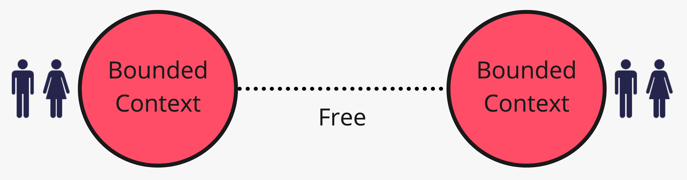

Um contexto delimitado, ou o time que trabalha nele, é livre quando as mudanças realizadas em outros contextos delimitados não influenciam seu sucesso ou fracasso. Portanto, não existe qualquer vínculo organizacional ou técnico entre esses times.

### Padrões do Mapa de Contextos (*Context Map Patterns*)

A maioria das publicações da comunidade de Domain-Driven Design descreve atualmente nove padrões de Context Mapping.

#### Serviço de host aberto (*Open-host Service*)

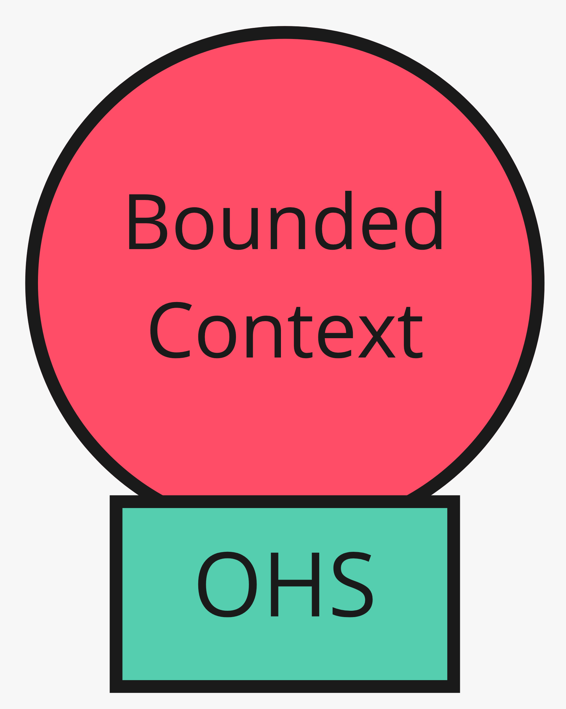

> “Defina um protocolo que forneça acesso ao seu subsistema como um conjunto de serviços. Torne o protocolo acessível a todos que precisem se integrar a ele. Aprimore e expanda o protocolo para atender a novos requisitos de integração, exceto quando um único time tiver necessidades muito específicas. Nesse caso, utilize um tradutor dedicado para complementar o protocolo, permitindo que o protocolo compartilhado permaneça simples e coerente.” — Tradução do [DDD Reference, de Eric Evans](https://www.domainlanguage.com/ddd/reference/).

O time que fornece um Serviço de host aberto geralmente ocupa a posição *upstream*, enquanto os clientes que o utilizam são times *downstream*. Os times *downstream* podem optar por ser conformistas ou construir camadas anticorrupção.

#### Conformista (*Conformist*)

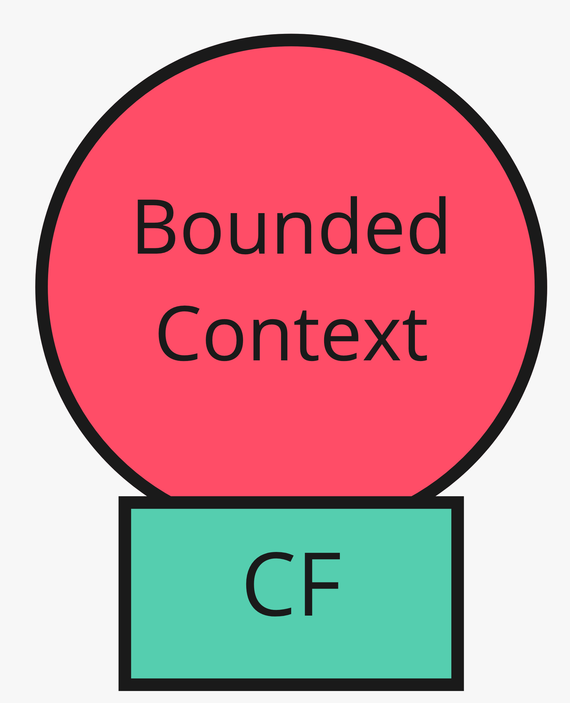

> “Elimine a complexidade da tradução entre contextos delimitados aderindo rigorosamente ao modelo do time upstream. Embora isso limite a liberdade dos designers downstream e provavelmente não produza o modelo ideal para a aplicação, escolher a conformidade simplifica enormemente a integração. Além disso, você compartilhará uma linguagem ubíqua com o time upstream. Como o upstream está no controle, é importante facilitar a comunicação com ele. O altruísmo pode ser suficiente para que compartilhem informações com você.” — Tradução do [DDD Reference, de Eric Evans](https://www.domainlanguage.com/ddd/reference/).

#### Camada anticorrupção (*Anticorruption Layer*)

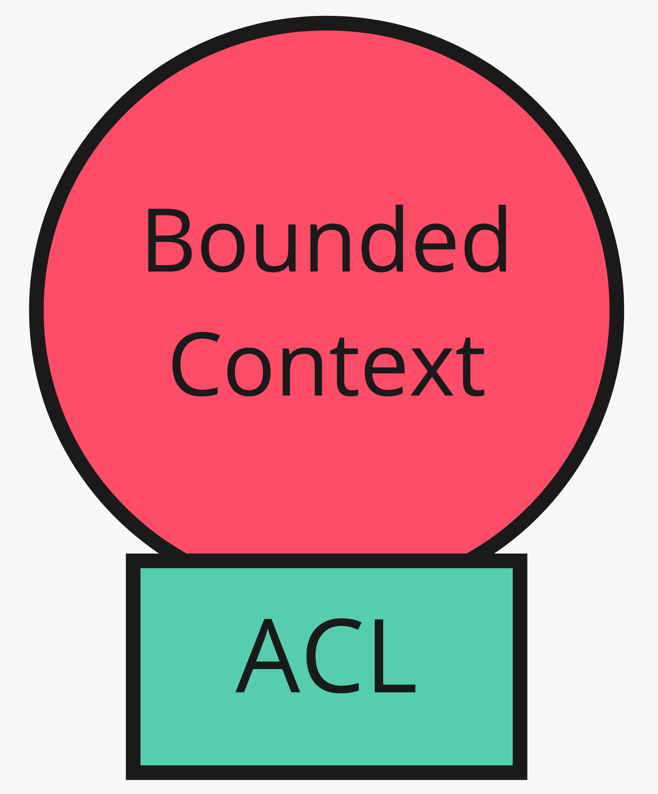

> “Como cliente downstream, crie uma camada de isolamento que forneça ao seu sistema as funcionalidades do sistema upstream nos termos do seu próprio modelo de domínio. Essa camada se comunica com o outro sistema por meio da interface existente, exigindo pouca ou nenhuma modificação no sistema externo. Internamente, a camada realiza a tradução necessária, em uma ou nas duas direções, entre os modelos.” — Tradução do [DDD Reference, de Eric Evans](https://www.domainlanguage.com/ddd/reference/).

#### Núcleo compartilhado (*Shared Kernel*)

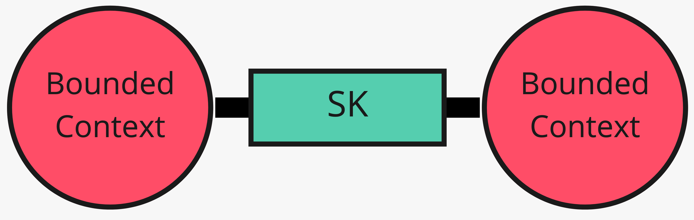

> “Defina, por meio de um limite explícito, um subconjunto do modelo de domínio que os times concordam em compartilhar. Mantenha esse núcleo pequeno. Dentro desse limite, inclua, junto ao subconjunto do modelo, a parte do código ou do design do banco de dados associada a ele. Esses elementos explicitamente compartilhados possuem um status especial e não devem ser alterados sem consultar o outro time.” — Tradução do [DDD Reference, de Eric Evans](https://www.domainlanguage.com/ddd/reference/).

#### Parceria (*Partnership*)

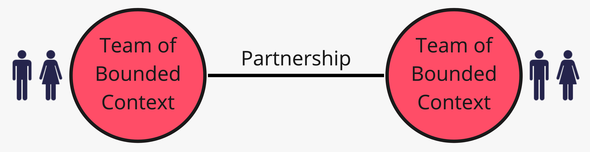

> “Quando uma falha no desenvolvimento de qualquer um dos dois contextos resultar em falha na entrega de ambos, estabeleça uma parceria entre os times responsáveis. Implemente um processo de planejamento coordenado do desenvolvimento e de gestão conjunta da integração. Os times devem cooperar na evolução de suas interfaces para acomodar as necessidades de desenvolvimento dos dois sistemas. Funcionalidades interdependentes devem ser planejadas para serem concluídas na mesma versão.” — Tradução do [DDD Reference, de Eric Evans](https://www.domainlanguage.com/ddd/reference/).

#### Desenvolvimento cliente/fornecedor (*Customer / Supplier Development*)

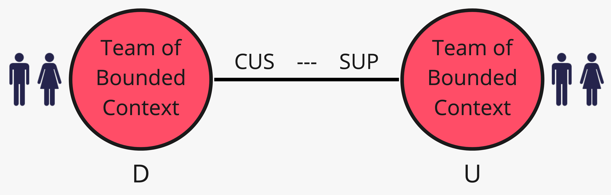

> “Quando dois times mantêm uma relação upstream/downstream, na qual o time upstream pode ser bem-sucedido independentemente do destino do downstream, as necessidades do downstream podem ser atendidas de diferentes maneiras, com consequências variadas. [...] Estabeleça uma relação clara de cliente e fornecedor entre os dois times, fazendo com que as prioridades downstream sejam consideradas no planejamento upstream. Negocie e reserve capacidade para os requisitos downstream, de modo que todos compreendam o compromisso e o cronograma.” — Tradução do [DDD Reference, de Eric Evans](https://www.domainlanguage.com/ddd/reference/).

#### Linguagem publicada (*Published Language*)

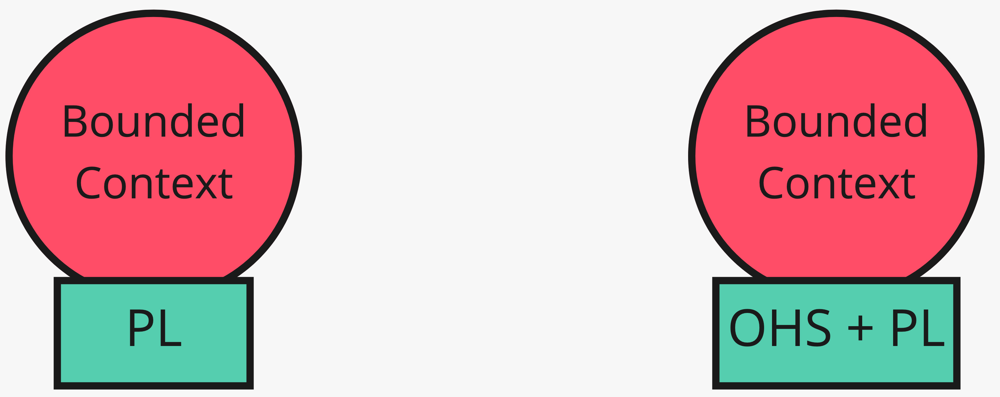

> “A tradução entre os modelos de dois contextos delimitados exige uma linguagem comum. [...] Utilize uma linguagem compartilhada e bem documentada, capaz de expressar as informações de domínio necessárias como um meio comum de comunicação, traduzindo para essa linguagem e a partir dela quando necessário.” — Tradução do [DDD Reference, de Eric Evans](https://www.domainlanguage.com/ddd/reference/).

Exemplos amplamente conhecidos de Linguagem publicada são o iCalendar e o vCard. Esse padrão costuma ser combinado com um Serviço de host aberto.

#### Caminhos separados (*Separate Ways*)

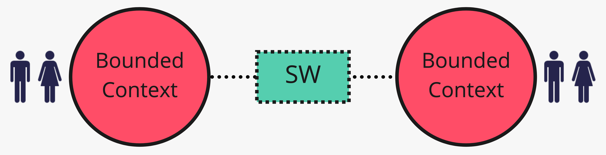

Quando dois contextos delimitados não possuem uma relação significativa, eles podem seguir caminhos separados.

> “Declare que um contexto delimitado não possui conexão alguma com os demais, permitindo que os desenvolvedores encontrem soluções simples e especializadas dentro desse escopo reduzido.” — Tradução do [DDD Reference, de Eric Evans](https://www.domainlanguage.com/ddd/reference/).

#### Grande bola de lama (*Big Ball of Mud*)

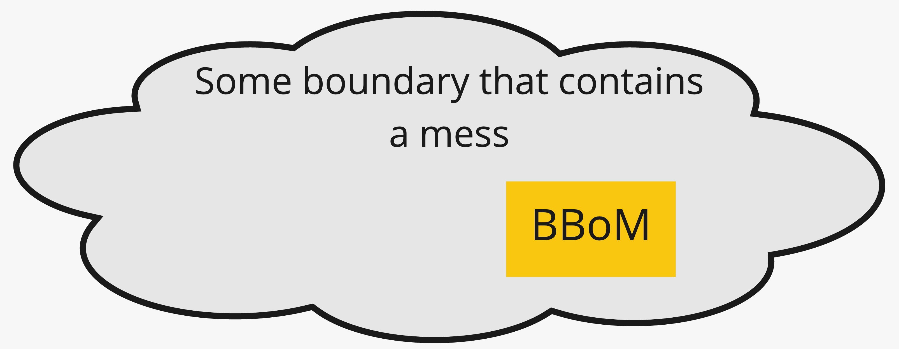

Uma Grande bola de lama representa um sistema, ou parte dele, desorganizado por misturar modelos e possuir limites inconsistentes. Não permita que esse modelo problemático se propague para outros contextos delimitados. O padrão demarca um modelo ou sistema de baixa qualidade que deve ser isolado para impedir que a desordem contamine os demais contextos.

## Boas práticas para Mapas de Contextos

Não é necessário colocar todos os padrões e relacionamentos entre times em um único Mapa de Contextos. Esse mapa tende a crescer ao longo do tempo e pode se tornar difícil de compreender. Também será necessário explicar um mapa complexo a diferentes partes interessadas, cada uma com perspectivas próprias decorrentes de sua função ou da natureza de seu trabalho.

Por isso, considere as seguintes orientações:

- prefira Mapas de Contextos pequenos para responder a perguntas explícitas;
- documente e explique os padrões que serão utilizados;
- trabalhe com diferentes perspectivas e crie vários mapas para representá-las.

### Mapas de Contextos pequenos para perguntas explícitas

Os Mapas de Contextos podem responder a uma grande variedade de perguntas, como:

- como o modelo de determinado sistema se propaga por uma paisagem de aplicações?
- que tipo de influência determinado time exerce sobre os demais?
- quem exerce influência sobre um time específico?
- como as relações políticas se manifestam?

Essas perguntas são bastante específicas. Embora seja possível respondê-las com base em um grande Mapa de Contextos, mais cedo ou mais tarde esse mapa produzirá sobrecarga de informação.

Portanto, trabalhe com mapas menores, destinados a responder a perguntas específicas. Inclua somente os padrões que realmente contribuam para encontrar essas respostas.

### Documente e explique os padrões que serão utilizados

Context Mapping é uma técnica poderosa para visualizar relações entre sistemas e times. No entanto, os mapas podem ser difíceis de compreender para pessoas sem experiência em Domain-Driven Design ou nos padrões de Context Mapping. Alguns nomes de padrões não são autoexplicativos para determinados grupos de partes interessadas, e o mesmo vale para algumas definições.

Antes de começar a desenhar os mapas, decida quais padrões serão utilizados. Forneça uma explicação desses padrões para você e para as demais partes interessadas. Certifique-se de que todas as pessoas envolvidas compreendam os padrões. Exemplos costumam ser especialmente úteis nessas explicações.

## Guia de referência rápida do Mapa de Contextos (*Context Map Cheat Sheet*)

O guia abaixo contém descrições breves dos padrões de Context Mapping:

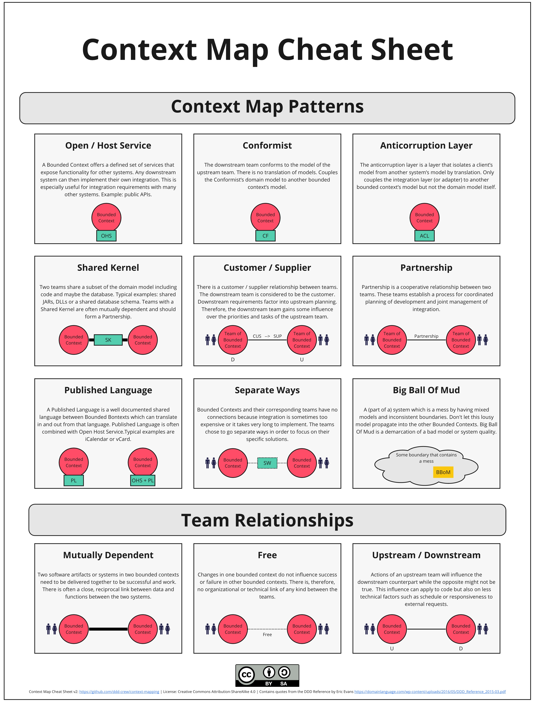

## Kit inicial remoto de Context Mapping para o Miro

Para realizar Context Mapping com o Miro, o repositório oferece um backup de quadro com os elementos necessários para representar padrões, relações entre times e limites. O quadro também contém alguns exemplos para facilitar os primeiros passos:

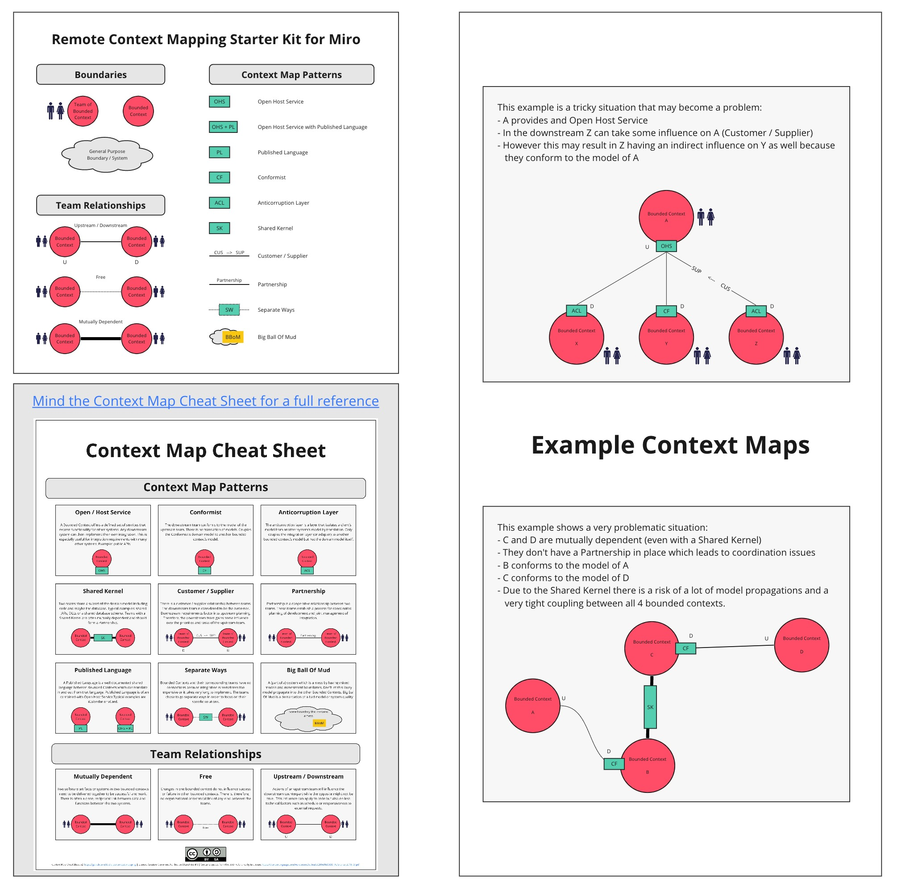

[Baixar o backup do quadro do Miro — conteúdo em inglês](../../resources/Remote-Context-Mapping-Starter-Kit.rtb)

Também é possível consultar e comentar uma [versão somente leitura do kit inicial no Miro](https://miro.com/app/board/o9J_kqtuB6A=/).

## Context Mapping com Context Mapper

Para manter os Mapas de Contextos no repositório de código, o [Context Mapper](https://contextmapper.org/) permite descrever os contextos em um arquivo de texto e gerar um diagrama a partir dele. O Context Mapper está disponível [on-line, no navegador por meio do Gitpod](https://contextmapper.org/docs/online-ide/), ou como extensão para o [Visual Studio Code](https://marketplace.visualstudio.com/items?itemName=contextmapper.context-mapper-vscode-extension) e o [Eclipse](https://marketplace.eclipse.org/content/context-mapper/).

## Leituras adicionais

- [Dynamic Reteaming](https://leanpub.com/dynamicreteaming)
- [Pioneers, Settlers & Town Planners](http://wardleypedia.org/mediawiki/index.php/Pioneers_settlers_town_planners)
- [Team Topologies](https://teamtopologies.com/)
- [Visualising Sociotechnical Architecture with Context Maps](https://speakerdeck.com/mploed/visualizing-sociotechnical-architectures-with-context-maps)

## Colaboradores

Agradecemos a todos os [colaboradores atuais e futuros](https://github.com/ddd-crew/context-mapping/graphs/contributors) e às seguintes pessoas, que contribuíram para o Context Map Cheat Sheet:

- [Kacper Gunia](https://twitter.com/cakper)
- [Nick Tune](https://github.com/ntcoding)

## Contribuições e feedback

O Context Map Cheat Sheet está disponível gratuitamente para uso. Comentários e ideias para aprimorar a técnica ou criar versões alternativas também são bem-vindos.

Em caso de dúvidas, entre em contato conosco ou abra uma [issue](https://github.com/ddd-crew/context-map-cheat-sheet/issues/new/choose).

Você também pode enviar um pull request com exemplos ou relatos de experiência.

Também é possível comentar diretamente no [quadro do Context Map Cheat Sheet no Miro](https://miro.com/app/board/o9J_kqrI8ck=/).

[![CC BY 4.0][cc-by-shield]][cc-by]

Este trabalho está licenciado sob a [Licença Internacional Creative Commons Atribuição 4.0][cc-by].

[![CC BY 4.0][cc-by-image]][cc-by]

[cc-by]: http://creativecommons.org/licenses/by/4.0/
[cc-by-image]: https://i.creativecommons.org/l/by/4.0/88x31.png
[cc-by-shield]: https://img.shields.io/badge/License-CC%20BY%204.0-lightgrey.svg
